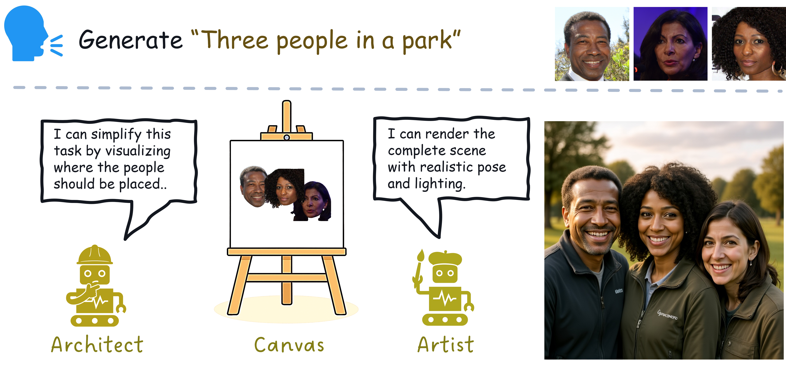

# Ar2Can: An Architect and an Artist Leveraging a Canvas for Multi-Human Generation

[](LICENSE)
[](https://arxiv.org/abs/2511.22690)
[](https://qualcomm-ai-research.github.io/ar2can/)

A multi-reference face composition pipeline using FLUX.1-Kontext (Artist) and FLUX.1-schnell (Architect) with LoRA adapters and an optional face segmentation and alignment.

## Abstract

Despite recent advances in personalized image generation, existing models consistently fail to produce reliable multi-human scenes, often merging or losing facial identity. We present Ar2Can, a novel two-stage framework that disentangles spatial planning from identity rendering for multi-human generation. The Architect predicts structured layouts, specifying where each person should appear. The Artist then synthesizes photorealistic images, guided by a spatially-grounded face matching reward that combines Hungarian spatial alignment with identity similarity. This approach ensures faces are rendered at correct locations and faithfully preserve reference identities. We develop two Architect variants, seamlessly integrated with our diffusion-based Artist model. This is optimized via Group Relative Policy Optimization (GRPO) using compositional rewards for count accuracy, image quality, and identity matching. Evaluated on the MultiHuman-Testbench, Ar2Can achieves substantial improvements in both count accuracy and identity preservation, while maintaining high perceptual quality. Notably, our method achieves these results using primarily synthetic data, without requiring real multi-human images.



---

## Notes

- The model weights released in this repository are not the same model reported in the paper. They are provided for research and demonstration purposes only.

---

## Table of Contents

- [How It Works](#how-it-works)
- [Prerequisites](#prerequisites)
- [Model Weights](#model-weights)
- [Quick Start (Docker)](#quick-start-docker)
- [Using Local Model Weights](#using-local-model-weights-avoid-re-downloading)
- [CLI Inference Options](#cli-inference-options-inferpy)
- [Environment Variables](#environment-variables)
- [Running without Docker](#running-without-docker-local-python)
- [Useful Docker Commands](#useful-docker-commands)
- [Directory Layout](#directory-layout)
- [Prompting Guide](#prompting-guide)
- [License](#license)
- [Contributing](#contributing)
- [Citation](#citation)

---

## How It Works

The pipeline has two stages:

1. **Architect** (FLUX.1-schnell + LoRA) — generates a 1024×1024 *probe* image from the text prompt. This establishes the scene layout and face positions.
2. **Artist** (FLUX.1-Kontext-dev + LoRA) — takes the probe's detected face regions, pastes the reference faces onto a canvas (with segmentation-based cropping and optional face alignment), and renders the final composition.

---

## Prerequisites

- Docker >= 20.10.
- NVIDIA driver >= 535, CUDA >= 12.1.
- GPUs with >= 70 GB VRAM (required for loading both models simultaneously).
- `nvidia-container-toolkit` for GPU access inside Docker.
- **Hugging Face account with access token** (see Quick Start below).

---

## Model Weights

The Architect and Artist LoRA adapter weights can be obtained in two ways:

**Option A: HuggingFace (automatic):** If `loras/architect/` or `loras/artist/` do not contain local checkpoints, the code automatically downloads the adapters from HuggingFace (`Qualcomm-AI-Research/ar2can`) at first run. No extra steps required.

**Option B: GitHub Release (manual):** Download the safetensors files from [GitHub Releases](https://github.com/Qualcomm-AI-research/ar2can/releases) and place them at:

```
ar2can/
├── loras/
│   ├── architect/
│   │   ├── adapter_config.json   ← already in repo
│   │   └── adapter_model.safetensors   ← download from release
│   └── artist/
│       ├── adapter_config.json   ← already in repo
│       └── adapter_model.safetensors   ← download from release
```

Override local paths via `ARCHITECT_LORA` / `ARTIST_LORA` env vars, or override the HuggingFace repo ID via `AR2CAN_LORA_HF`.

---

## Quick Start (Docker)

### 1. Get Hugging Face Access

1. Create account at https://huggingface.co/join.
2. Accept model terms at https://huggingface.co/black-forest-labs/FLUX.1-schnell.
3. Get your token from https://huggingface.co/settings/tokens (read access is sufficient).
4. Set the token in your environment:

```bash
export HF_TOKEN=your_hf_token_here
```

### 2. Build the image

```bash
docker build -t ar2can .
```

### 3. Run the container

```bash
docker run -it --gpus all -p 7865:7865 \
  -e HF_TOKEN=${HF_TOKEN} \
  ar2can bash
```

### 4. Inside the container, start the app

```bash
python3.11 app.py
```

### 5. Access the web UI

Open your browser to http://localhost:7865.

### 6. Run a CLI inference job (optional)

Inside the container:

```bash
python3.11 infer.py \
  --faces faces/person_1.webp faces/person_2.webp \
  --prompt "Two people in a sunny forest, ultra-realistic, 8K" \
  --output output.png
```

This saves three files alongside the primary output (`output.png`):
- `output.png` — final Artist result.
- `output_probe.png` — Architect probe (scene layout).
- `output_canvas.png` — combined canvas (reference faces pasted before Artist).

> **Note:** The backslash line-continuation syntax above is for Unix/macOS shells.
> On Windows PowerShell, use a back-tick as the line-continuation character instead of a backslash.

---

## Using Local Model Weights (avoid re-downloading)

Mount your Hugging Face cache and point the environment variables at it:

```bash
docker run -it --gpus all -p 7865:7865 \
  -v ~/.cache/huggingface:/root/.cache/huggingface \
  -e ARCHITECT_DIR=/root/.cache/huggingface/hub/models--black-forest-labs--FLUX.1-schnell/snapshots/... \
  -e ARTIST_DIR=/root/.cache/huggingface/hub/models--black-forest-labs--FLUX.1-Kontext-dev/snapshots/... \
  ar2can bash
```

Or simply let `diffusers` download on first run — the cache persists across container restarts via the mount.

---

## CLI Inference Options (`infer.py`)

| Flag | Default | Description |
|---|---|---|
| `--faces` | `faces/person_{1..3}.webp` | Reference face images (1–5) |
| `--prompt` | (built-in) | Scene description |
| `--output` | `output.png` | Output path (probe and canvas saved alongside) |
| `--steps-architect` | `4` | Architect inference steps |
| `--guidance-architect` | `0.0` | Architect CFG scale |
| `--steps-artist` | `20` | Artist inference steps |
| `--guidance-artist` | `2.6` | Artist CFG scale |
| `--face-scale` | `1.10` | Scale factor for face alignment |
| `--target-pad` | `1.0` | Target box padding ratio |
| `--mask-mode` | `segmentation` | Segmentation mask mode: `loose`, `tight` |
| `--seed` | `0` | RNG seed |
| `--no-seg` | `false` | Disable segmentation |
| `--no-align` | `false` | Disable face alignment |
| `--use-fg-mask` | `false` | Pass foreground mask as `cond_image_mask` to Artist |

---

## Environment Variables

All variables have defaults; override them via `-e VAR=value` or `--env-file`.

| Variable | Default | Description |
|---|---|---|
| `ARCHITECT_DIR` | `black-forest-labs/FLUX.1-schnell` | Path or HF repo for Architect model |
| `ARCHITECT_LORA` | `loras/architect` | Local path to Architect LoRA adapter directory |
| `ARTIST_DIR` | `black-forest-labs/FLUX.1-Kontext-dev` | Path or HF repo for Artist model |
| `ARTIST_LORA` | `loras/artist` | Local path to Artist LoRA adapter directory |
| `AR2CAN_LORA_HF` | `Qualcomm-AI-Research/ar2can` | HuggingFace repo ID used when local LoRA paths are absent |
| `ARTIST_LORA_2` | (none) | Optional second Artist LoRA |
| `GUIDANCE_ARCHITECT` | `0.0` | CFG scale for Architect stage |
| `STEPS_ARCHITECT` | `4` | Inference steps for Architect stage |
| `GUIDANCE_ARTIST` | `2.4` | CFG scale for Artist stage |
| `STEPS_ARTIST` | `20` | Inference steps for Artist stage |
| `PROBE_H` | `1024` | Probe image height |
| `PROBE_W` | `1024` | Probe image width |
| `DET_BACKBONE` | `retinaface/mobilenet` | Face detector backbone |
| `DET_SCORE` | `0.5` | Face detector confidence threshold |
| `USE_SEGMENTATION` | `1` | Enable foreground segmentation (`0` to disable) |
| `SEG_PARSE_BACKBONE` | `farl/celebm/448` | Segmentation parser backbone |
| `ALIGN_REF_FACES` | `1` | Enable reference face alignment (`0` to disable) |
| `FACE_SCALE` | `1.10` | Default face scale |
| `TARGET_PAD` | `1.20` | Default target box padding |
| `SAVED_PROBES_DIR` | `saved_probes` | Directory for pre-cached probe images |
| `PROMPT_CACHE_JSON` | `saved_probes/manifest.json` | Prompt cache manifest JSON |
| `AUTO_GENERATE_CACHE_PROBES` | `1` | Auto-generate missing probes on startup (`0` to skip) |

---

## Running without Docker (local Python)

### Conda

```bash
conda env create -f environment.yml
conda activate ar2can
python app.py
```

Or:

```bash
python infer.py --faces faces/person_1.webp --prompt "..."
```

### pip

```bash
pip install -r requirements.txt
python app.py
```

---

## Useful Docker Commands

```bash
# Rebuild after code changes
docker build -t ar2can .

# Enter a running container by name
docker exec -it ar2can bash

# Check GPU visibility
docker run --rm --gpus all ar2can nvidia-smi

# Remove image
docker rmi ar2can
```

---

## Directory Layout

```text
ar2can/
├── app.py                      # Gradio demo
├── infer.py                    # Standalone CLI inference
├── pipeline/
│   ├── artist_pipeline_multicond.py
│   └── canvas.py               # Detection, segmentation, canvas helpers
├── loras/
│   ├── architect/              # Architect LoRA weights
│   └── artist/                 # Artist LoRA weights
├── faces/                      # Reference face images
├── saved_probes/               # Pre-cached probe images + manifest.json
├── assets/
│   └── teaser.png              # Teaser image
├── requirements.txt
├── environment.yml
└── Dockerfile
```

---

## Prompting Guide

### Quality and lighting descriptors

```
8K, ultra-realistic, realistic lighting and shadows, high dynamic range, brilliant photography
DSLR picture, realistic image, realistic lighting and shadows, brilliant photography
```

### Anatomy reminders (recommended for 3+ people)

```
Realistic limb placement and person ordering.
Realistic anatomy.
Realistic occlusions between people.
```

### Identity instruction

Include the following anywhere in your prompt:

```
Preserve exact facial identity.
```

---

## License

This project is licensed under the BSD-3-Clause-Clear license.
See [LICENSE](LICENSE) for the full license text.

> **Disclaimer:** The Artist base model [FLUX.1-Kontext-dev](https://huggingface.co/black-forest-labs/FLUX.1-Kontext-dev) is released under a [Non-commercial License](https://huggingface.co/black-forest-labs/FLUX.1-Kontext-dev/blob/main/LICENSE.md). Consequently, the Ar2Can Artist LoRA weights are derived from FLUX.1-Kontext-dev and are therefore also subject to those Non-commercial License restrictions. Any use of the Ar2Can Artist LoRA weights must comply with the FLUX.1-Kontext-dev Non-commercial License terms. The full license text is available in [LICENSE-FLUX1-dev.txt](LICENSE-FLUX1-dev.txt).

---

## Contributing

Contributions are welcome. Please open an issue or pull request on the repository.
For significant changes, open an issue first to discuss the proposed change.

---

## Citation

If you find this work useful, please cite:

```bibtex
@inproceedings{borse2026ar2can,
  title={Ar2can: An architect and an artist leveraging a canvas for multi-human generation},
  author={Borse, Shubhankar and Pham, Phuc and Farhadzadeh, Farzad and Choi, Seokeon and Nguyen, Phong and Tran, Anh and Yun, Sungrack and Hayat, Munawar and Porikli, Fatih},
  booktitle={Proceedings of the IEEE/CVF Conference on Computer Vision and Pattern Recognition},
  pages={550--560},
  year={2026}
}
```
